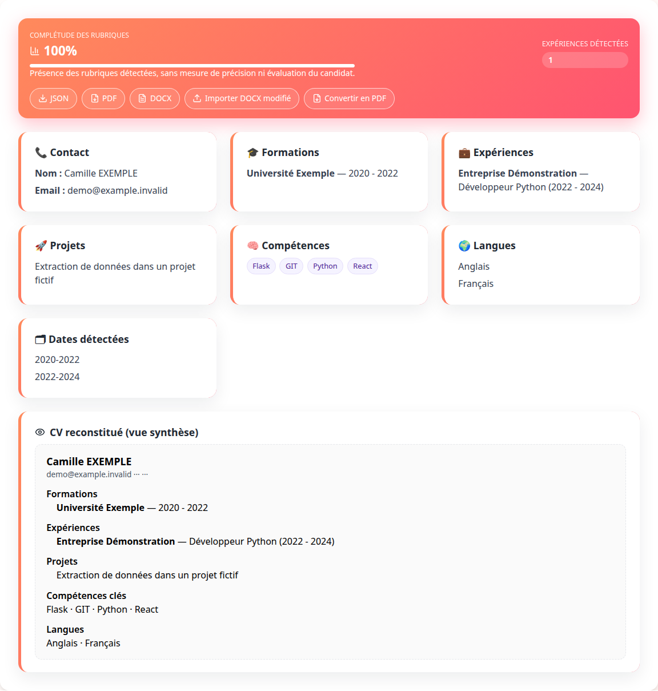
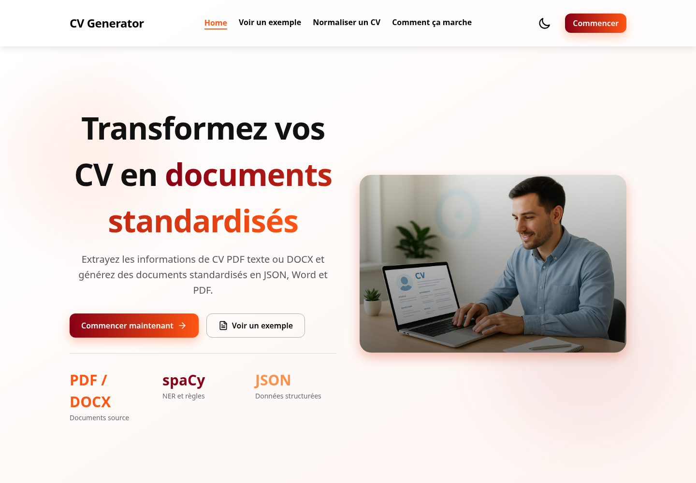
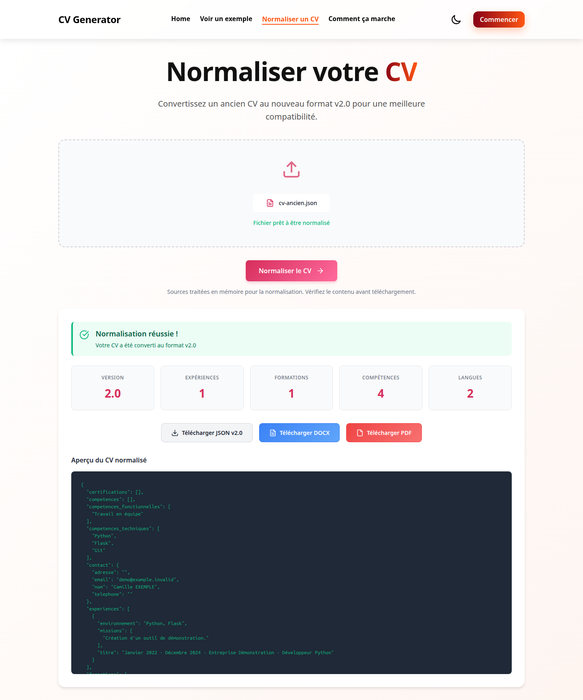
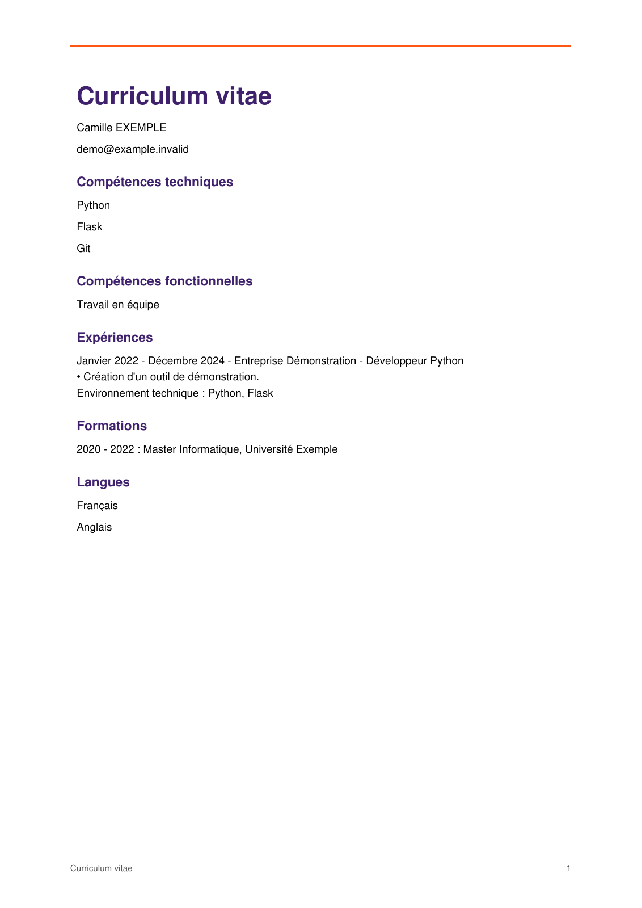
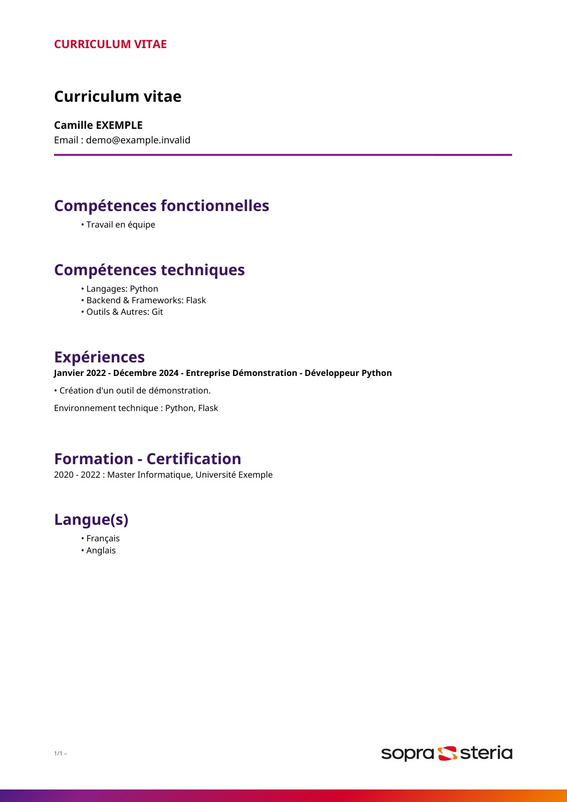
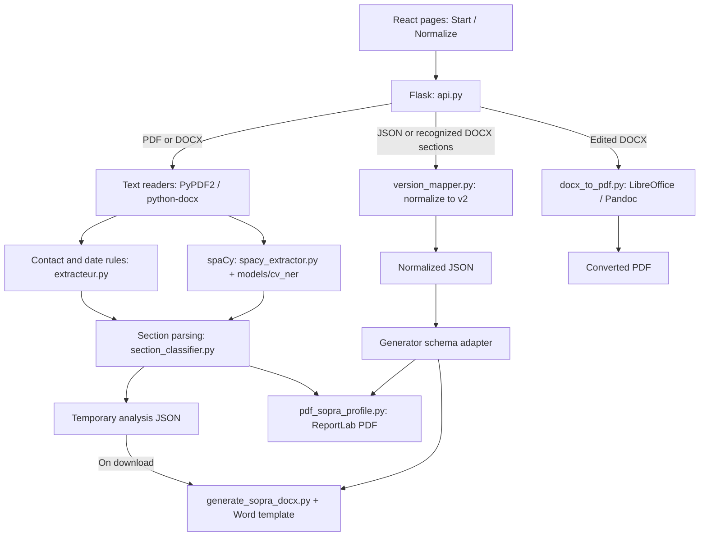

# CV Extraction & Document Generation

An academic full-stack application that turns text-based PDF and Word CVs into structured JSON, then generates Word and PDF documents. It combines a React interface, a Flask API, French spaCy named entity recognition (NER), and parsing rules.

**Status:** academic prototype with local tests and reproducible demonstrations. The interface is in French. Extraction quality and ATS compatibility have not been benchmarked.

[Demo](#try-it-with-fictional-data) · [Architecture](#architecture) · [Setup](#installation-and-local-run) · [Tests](#tests-and-verification) · [Limitations](#known-limitations-and-next-steps)



*Actual local application result using the [fictional demo input](examples/cv-demo.txt). The displayed completeness indicator counts populated sections; it is not an NLP accuracy score.*

## Implemented features

| Workflow | Supported input | Result |
|---|---|---|
| CV extraction | Text-based PDF or DOCX, including Word tables | Structured contact details, education, experience, skills, languages, and other recognized sections |
| Document generation | Extracted CV data | Template-based DOCX and a separately composed ReportLab PDF |
| Schema normalization | Legacy JSON, extraction JSON, or DOCX with recognized headings | Version 2 JSON, with JSON/DOCX/PDF exports |
| Edited Word conversion | A re-uploaded DOCX | PDF through LibreOffice, or Pandoc with a PDF engine |
| Web interface | File upload and result review | Downloads, persistent light/dark theme, and mobile navigation |

Extraction reads an existing CV. Generation formats its data into documents; it does not write a new professional history. No external LLM service is called by the application.

<details>
<summary>View the interface and real document exports</summary>





| Direct PDF export | Generated Word document, rendered through LibreOffice |
|---|---|
|  |  |

These exports use the same fictional normalization input. Their layouts are different because they use separate generators.

</details>

See the [complete screenshot gallery](docs/images/README.md) and [reproduction protocol](docs/DEMONSTRATIONS.md). The `/example` page is a built-in fictional illustration, not a live extraction result.

## Technology stack

| Layer | Technologies used in the code |
|---|---|
| Frontend | JavaScript/JSX, React 19, React Router 7, Vite 7, Tailwind CSS 4, Lucide and React Icons |
| Backend | Python, Flask 3, Flask-Cors; Gunicorn in the hosting configuration |
| NLP and parsing | spaCy 3.8, bundled French NER model, regular expressions, dateparser |
| Document processing | python-docx, PyPDF2, ReportLab, lxml |
| Verification | pytest, ESLint, Vite build, Playwright browser script, GitHub Actions configuration |

Direct Python versions are pinned in [requirements.txt](Projet-Sopra-Steria-main/backend/requirements.txt). Frontend dependencies are defined in [package.json](Projet-Sopra-Steria-main/frontend/package.json) and its lockfile. Playwright is an optional verification tool installed separately from the application.

## Architecture



The API orchestrates both workflows. Analysis JSON and its direct PDF are retained temporarily; Word is generated from stored JSON when downloaded. Normalized exports are generated in memory.

| Responsibility | Implementation |
|---|---|
| HTTP routes, upload validation, result storage and expiry | [api.py](Projet-Sopra-Steria-main/backend/api.py) |
| Word paragraphs and tables; PDF text extraction | [analyser_cv.py](Projet-Sopra-Steria-main/backend/analyser_cv.py), [pdf_to_docx.py](Projet-Sopra-Steria-main/backend/extractors/pdf_to_docx.py) |
| Regex, entities and section assembly | [extracteur.py](Projet-Sopra-Steria-main/backend/extractors/extracteur.py), [spacy_extractor.py](Projet-Sopra-Steria-main/backend/extractors/spacy_extractor.py), [section_classifier.py](Projet-Sopra-Steria-main/backend/extractors/section_classifier.py) |
| JSON normalization and generator adaptation | [version_mapper.py](Projet-Sopra-Steria-main/backend/extractors/version_mapper.py) |
| Word generation, direct PDF, external conversion | [generators/](Projet-Sopra-Steria-main/backend/generators) |
| Routes and API client | [App.jsx](Projet-Sopra-Steria-main/frontend/src/App.jsx), [api.js](Projet-Sopra-Steria-main/frontend/src/utils/api.js) |

### NLP processing

1. DOCX text is read from paragraphs and tables. PDF text is extracted with PyPDF2 and placed in a temporary DOCX for the same reader. This step does not preserve the original PDF layout.
2. Regex rules extract contacts and dates. The bundled spaCy model identifies entities such as people, companies, schools, diplomas, job titles, and skills.
3. Section rules combine these signals into JSON fields such as `contact`, `formations`, `experiences`, `competences`, and `langues`. Recognized projects, certifications, and interests are also included.

The active API model defaults to `backend/models/cv_ner`. If loading it fails, the code attempts the separately installed `fr_core_news_md` model. Saved NER/TextCat models under `models/cv_pipeline/` and the experimental extractor are present but are not used by the current API path. Training scripts and loss reports are not an independent quality evaluation.

### Normalization and generation

[version_mapper.py](Projet-Sopra-Steria-main/backend/extractors/version_mapper.py) maps supported inputs to a version 2 schema and adapts that schema for document generators. It preserves structured fields and supported legacy blocks; it does not infer missing career facts.

Word output uses `templates/sopra_template.docx` through python-docx. Direct PDF output uses ReportLab with text wrapping and pagination. Converting an edited Word file is a separate operation requiring LibreOffice or Pandoc with a PDF engine; it returns an unavailable-service error if no converter is installed.

## Repository structure

```text
.
├── README.md
├── .github/workflows/ci.yml       # Backend tests and frontend checks
├── pytest.ini
├── examples/                      # Fictional CV and legacy JSON inputs
├── scripts/                       # Demo input creation and browser verification
├── docs/
│   ├── images/                    # Authentic screenshots and export renders
│   ├── DEMONSTRATIONS.md
│   ├── VALIDATION.md
│   └── ATTRIBUTION.md
├── Procfile, render.yaml, vercel.json
└── Projet-Sopra-Steria-main/
    ├── backend/
    │   ├── api.py                 # API entry point
    │   ├── analyser_cv.py
    │   ├── extractors/            # Parsing, NER and normalization
    │   ├── generators/            # Word, PDF and conversion
    │   ├── models/                # Bundled spaCy models
    │   ├── templates/
    │   ├── training/
    │   ├── requirements*.txt
    │   └── test_*.py
    ├── frontend/src/              # React pages, components and API utility
    └── Docs/                      # Detailed technical notes, in French
```

Hosting configuration is included; a working production deployment was not verified. See the [hosting configuration notes](docs/DEPLOYMENT.md).

## Installation and local run

### Prerequisites

- Python **3.12**: tested locally with 3.12.3 on Linux.
- Node.js satisfying `^20.19.0 || >=22.12.0`: tested locally with **22.14.0**, npm **11.6.2**.
- Optional: LibreOffice available as `soffice`/`libreoffice`, or Pandoc with a PDF engine, for edited-DOCX conversion. Direct PDF generation does not require either tool.

Run all commands from the **Git repository root**, where this README is located.

```bash
python3 -m venv .venv
source .venv/bin/activate
python -m pip install -r Projet-Sopra-Steria-main/backend/requirements-dev.txt
npm ci --ignore-scripts --prefix Projet-Sopra-Steria-main/frontend
```

For runtime dependencies only, use `backend/requirements.txt` instead of `requirements-dev.txt`. The custom NER model is already included; a base-model download is not required for the default path.

Start the backend in a terminal with the virtual environment active:

```bash
python Projet-Sopra-Steria-main/backend/api.py
```

Start the frontend in another terminal:

```bash
npm run dev --prefix Projet-Sopra-Steria-main/frontend
```

Open [the interface](http://localhost:5173) and [API health endpoint](http://127.0.0.1:5000/api/health). Vite proxies `/api` to the local backend. Flask runs on `127.0.0.1:5000` with debug mode disabled.

<details>
<summary>Windows environment activation — not verified locally</summary>

Replace the first two setup commands with these PowerShell commands, then run the same dependency installation commands:

```powershell
py -3.12 -m venv .venv
.venv\Scripts\Activate.ps1
```

Windows and macOS execution, Node 20, and the Pandoc conversion path were not tested. See [verification scope](docs/VALIDATION.md).

</details>

### Configuration

| Variable | Default / purpose |
|---|---|
| `VITE_API_URL` | Empty: same-origin requests, with the Vite proxy in development. Set the actual backend URL at build time for separate hosting. See [frontend/.env.example](Projet-Sopra-Steria-main/frontend/.env.example). |
| `CV_ALLOWED_ORIGINS` | `http://localhost:5173,http://127.0.0.1:5173`; comma-separated CORS origins |
| `CV_DATA_DIR` | `backend/data/jobs`, resolved relative to the backend module by default |
| `CV_RETENTION_SECONDS` | `3600`; analysis result lifetime in seconds |
| `CV_NER_MODEL_PATH` | Bundled `backend/models/cv_ner` directory |
| `HOST`, `PORT` | Development server: `127.0.0.1`, `5000` |

Set backend variables in the shell or hosting environment. The API does not automatically load a `.env` file.

## Try it with fictional data

The supplied examples are explicitly fictional. They use **Camille EXEMPLE**, **Université Exemple**, **Entreprise Démonstration**, and `demo@example.invalid`.

With the Python environment active, create demo files outside the repository:

```bash
python scripts/create_demo_inputs.py --output /tmp/cv-demo-inputs
```

1. Open `/start` and upload `/tmp/cv-demo-inputs/cv-demo.docx` or `cv-demo.pdf`.
2. Select **Analyser le CV**, review the extracted data, and download JSON, Word, or PDF.
3. Open `/normalize`, upload [examples/cv-ancien.json](examples/cv-ancien.json), and export the normalized data or documents.
4. Optionally edit the downloaded Word file and use **Importer DOCX modifié**. This conversion requires the external tool described above.

The analysis endpoint can also be called directly:

```bash
curl -F 'file=@/tmp/cv-demo-inputs/cv-demo.docx' \
  http://127.0.0.1:5000/api/cv/analyze
```

This uses a real input, not a prewritten response. The fixture is useful for reproduction; it is not evidence of general extraction accuracy.

### API overview

| Method | Route | Input or purpose |
|---|---|---|
| GET | `/health`, `/api/health` | Service health |
| POST | `/api/cv/analyze` | Multipart `file`: PDF with text or DOCX |
| GET | `/api/cv/docx/<token>` | Generate Word from an unexpired analysis |
| GET | `/api/cv/pdf/<token>.pdf` | Download the analysis PDF |
| POST | `/api/cv/normalize` | Multipart JSON/DOCX, or JSON body with a `cv_data` object |
| POST | `/api/cv/normalize-batch` | JSON body with a `cvs` array, at most 100 entries |
| POST | `/api/cv/normalize/docx`, `/api/cv/normalize/pdf` | Normalize and export a document |
| POST | `/api/cv/convert` | Multipart `file`: edited DOCX |

Analysis returns `json_filename` and `pdf_filename` with random identifiers. Remove `.json` from `json_filename` to obtain the Word download token. Unknown or expired results return HTTP 404. The request size limit is **10 MiB**, including multipart overhead. The [normalization reference](Projet-Sopra-Steria-main/Docs/NORMALISATION_CV.md) describes the supported schema in French.

## Tests and verification

With development dependencies installed, run from the repository root:

```bash
python -m pytest -q
npm run lint --prefix Projet-Sopra-Steria-main/frontend
npm run build --prefix Projet-Sopra-Steria-main/frontend
```

Local verification recorded **44 passing backend tests**, successful lint and build, and real browser workflows using fictional data. Tests cover section separation, Word tables, repeated normalization, document generation, exports, upload limits, and result expiry. Real LibreOffice conversion was tested; that test is skipped when LibreOffice is absent.

The [validation record](docs/VALIDATION.md) separates tested commands from unverified environments. The [browser protocol](docs/DEMONSTRATIONS.md) uses the real API without mocked responses. The [GitHub Actions workflow](.github/workflows/ci.yml) passed both backend and frontend jobs for commit `1f202b0`: [verified run](https://github.com/arabat-med/Projet-CV-ATS-main/actions/runs/41063019814). CI success does not validate a production deployment or NLP accuracy.

## Data handling

- Uploaded analysis sources are removed after processing, including failures. Analysis JSON and PDF remain temporarily on the server.
- Results become inaccessible after expiry. Physical cleanup is triggered by later requests, rather than guaranteed at the exact expiry time.
- Normalized exports use memory buffers. External conversion uses a temporary directory.
- Result links grant access to anyone who has them. There are no user accounts or authentication; use fictional data for public demonstrations.
- Local data folders, generated files, environments, and `.env` files are ignored by Git. Generated CVs are not anonymized.

See [attribution and publication notes](docs/ATTRIBUTION.md) for the remaining review of historical data and reuse rights.

## Known limitations and next steps

| Current limitation | Possible improvement |
|---|---|
| No OCR; scanned PDFs without text are unsupported | Add an explicit OCR workflow with appropriate fixtures |
| French-oriented model and rules; extraction depends on document structure | Build a separate, representative evaluation set and measure per-field/NER quality |
| Original PDF layout is not preserved; Word and PDF exports have different layouts | Expand layout regression checks and document font requirements |
| No database, user history, authentication, or background queue | Define access control and processing requirements before wider deployment |
| No validated production setup, load test, or ATS compatibility benchmark | Validate deployment and measure behavior before making related claims |

These are proposed improvements, not implemented features. PyPDF2 and Typer/Click also emit dependency deprecation warnings in the recorded test environment.

## Maintainer and attribution

Portfolio maintainer: **[arabat-med](https://github.com/arabat-med)**. Repository: **[Projet-CV-ATS-main](https://github.com/arabat-med/Projet-CV-ATS-main)**.

This is a collective academic project. Historical documentation describes an educational context involving Sopra Steria; the supplied Word template comes from the original project. This README does not imply current commercial affiliation or sole authorship. See [project credits and licensing notes](docs/ATTRIBUTION.md). A personal contribution statement and a project-wide reuse license still need clarification.
